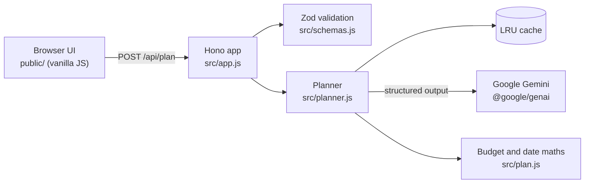

# 🎉 Celebrate: AI planning assistant for celebrations

> **PromptWars · Challenge 5: Celebration & Event Planner**
>
> **Live demo:** <https://celebrate.greenmeadow-4e76982d.centralindia.azurecontainerapps.io>

Celebrate turns a few details about a wedding, birthday or community event into a complete,
personalised plan: a **budget split**, a **dated timeline**, a **vendor checklist** and **creative
ideas**. Google Gemini generates the plan, and the user can refine it through conversation.

## What it does

| Challenge need                        | How Celebrate delivers it                                                                                                                                                                                                                                                 |
| ------------------------------------- | ------------------------------------------------------------------------------------------------------------------------------------------------------------------------------------------------------------------------------------------------------------------------- |
| Weddings, birthdays, community events | Event-aware planning: ceremonies and traditions for weddings, age and interests for birthdays, permits, volunteers and safety for community events, plus "other celebrations"                                                                                             |
| Budgets                               | Gemini proposes a category split, with a 5-10% contingency, that suits the location and budget per guest. The server turns it into exact amounts that always add up to the total                                                                                          |
| Timelines                             | Tasks become real calendar dates counted back from the event, ending with a run of the day. Late tasks are flagged **Do now**, tasks can be ticked off with progress saved in the browser, and one click exports every date to Google, Outlook or Apple Calendar (`.ics`) |
| Vendor checklists                     | Prioritised bookings with book-by dates and "what to ask" tips. Ticking off vendors shows progress, which is saved in the browser                                                                                                                                         |
| Personalised ideas                    | Theme, décor, food and activity ideas drawn from who the event is for, the stated preferences, culture, season and location. Anything already booked is left out of the plan, and assumptions about missing details are stated in the summary                             |
| Iteration                             | **Refine with AI** revises the current plan from plain-language feedback such as "cut costs by 20%". Bookings and finished tasks that are still in the plan stay ticked                                                                                                   |
| Inclusion                             | Plans in six languages. Every plan considers guest accessibility (step-free access, seating, diets), low-waste choices and a weather backup for anything outdoors                                                                                                         |

## How GenAI is used

1. **Structured generation:** `gemini-3.6-flash` returns JSON constrained by `responseJsonSchema`.
   That schema is generated from the same Zod schema that validates the response
   ([src/schemas.js](src/schemas.js)), so the contract and the validation can never drift apart.
2. **AI for judgement, code for arithmetic:** the model chooses categories, shares, tasks, lead
   times and ideas. Deterministic code ([src/plan.js](src/plan.js)) computes amounts (using the
   largest-remainder method) and calendar dates. The prompt states facts the model would otherwise
   have to derive, such as days remaining and budget per guest.
3. **Conversational refinement:** the client sends the current plan and the user's feedback. The
   server re-validates both, so the API stays stateless and scales horizontally.
4. **Guardrails:** a fixed system instruction, user data passed as JSON inside delimited tags with
   `<` and `>` escaped (so it cannot close a tag), explicit safety settings that block harmful
   content, schema-constrained output, strict validation, and a friendly message when Gemini blocks
   a prompt or withholds an answer.
5. **Latency and resilience:** low thinking level and an LRU cache for identical prompts. If a
   model is overloaded, slow or returns an unusable plan, the planner moves on to the next model
   (`gemini-3.5-flash-lite` by default) instead of re-asking the busy one. Each attempt has a
   30-second deadline that Gemini also enforces, and requests are cancelled when the browser
   disconnects. Measured live: a plan takes about 6 seconds on `gemini-3.6-flash` and 4 seconds on
   Flash-Lite.

## Architecture



```text
src/
  server.js      entry point: config, Gemini client, HTTP server, graceful shutdown
  app.js         routes, security headers, validation, error handling
  planner.js     Gemini call, response validation, caching, error mapping
  prompt.js      system instruction and prompt builder
  schemas.js     Zod schemas (request and AI response) and the Gemini JSON Schema
  plan.js        exact budget split and calendar scheduling
  rate-limit.js  per-client fixed-window rate limiter
  cache.js       LRU cache with expiry
  config.js      validated environment configuration
  dates.js       UTC calendar-day helpers
  errors.js      AppError with a user-safe message
  log.js         structured JSON logging for Cloud Logging and Azure Monitor
public/          index.html, styles.css, favicon.svg, .well-known/security.txt
  js/            main, app, state, form, api, storage, shape, render, ics
test/            node:test suites (unit, integration, UI, accessibility) and a live Gemini eval
```

## Code quality

- **Small and dependency-light:** about 1,150 lines of application code (excluding comments)
  across single-purpose modules, four runtime dependencies and no build step.
- **Type-checked JavaScript:** JSDoc types are verified by TypeScript in `strict` mode
  (`npm run typecheck`). The browser code imports the server's plan type, so the API response
  has one definition shared by both sides.
- **One source of truth:** the Zod plan schema generates Gemini's JSON Schema and validates its
  answer; configuration defaults live only in [src/config.js](src/config.js).
- **Testable by design:** the Gemini client, planner, clock and logger are injected, so every
  module runs in tests without a network or API key. In the browser, state changes (new plan,
  refinement, undo, ticking items off) are pure functions in
  [public/js/state.js](public/js/state.js), tested without a DOM; `app.js` only wires events to
  them and renders the result.
- **Enforced in CI:** Biome lint and formatting (recommended rules plus a cognitive-complexity
  limit), the strict type check and 100% coverage must all pass.
- **Measured:** the SonarJS rule set (the rules behind SonarQube) reports no issues, and jscpd
  finds 0.13% duplicated lines (one repeated pair of form live regions in the HTML).

## Quick start

Requires Node.js 22.12 or later and a [Gemini API key](https://aistudio.google.com/apikey).

```bash
npm ci
cp .env.example .env    # then set GEMINI_API_KEY
npm run dev             # http://localhost:8080
```

| Script              | Purpose                                                                |
| ------------------- | ---------------------------------------------------------------------- |
| `npm run dev`       | Start with auto-reload, loading `.env`                                 |
| `npm start`         | Start in production mode                                               |
| `npm test`          | Run all tests; fails unless every line, branch and function is covered |
| `npm run lint`      | Biome lint and format check (`npm run format` applies fixes)           |
| `npm run typecheck` | Strict TypeScript check of the JSDoc-typed JavaScript                  |
| `npm run eval`      | Live evaluation of real Gemini plans (needs `GEMINI_API_KEY`)          |
| `npm run check`     | Lint, type check and tests, as CI runs them                            |

| Variable                       | Default                                  | Purpose                                                                                                        |
| ------------------------------ | ---------------------------------------- | -------------------------------------------------------------------------------------------------------------- |
| `GEMINI_API_KEY`               | (required unless the file is set)        | Gemini API key, for local development                                                                          |
| `GEMINI_API_KEY_FILE`          | (unset)                                  | Path to a mounted secret file holding the key; preferred in production                                         |
| `GEMINI_MODELS`                | `gemini-3.6-flash,gemini-3.5-flash-lite` | Models to try, in order (each must support structured output)                                                  |
| `PORT`                         | `8080`                                   | HTTP port                                                                                                      |
| `RATE_LIMIT_PER_MINUTE`        | `10`                                     | Plan requests allowed per client per minute                                                                    |
| `GLOBAL_RATE_LIMIT_PER_MINUTE` | `120`                                    | Plan requests allowed per minute across all clients (caps AI spending)                                         |
| `TRUSTED_PROXIES`              | `0`                                      | Proxies that append to `X-Forwarded-For`: `1` on Azure Container Apps or Cloud Run, `2` behind a load balancer |

## Testing

`npm test` runs on Node's built-in test runner with no network access or API key: Gemini is
replaced by a test double.

- **Unit:** schemas, budget and date maths, prompt building, cache, rate limiter, configuration
  (including the secret file and key checks), log masking, and the browser state transitions.
- **Service:** planner behaviour for success, caching, model fallback, malformed or incomplete AI
  output, blocked prompts, timeouts, quota errors, outages and abandoned requests.
- **HTTP integration:** the real Hono app via `app.request()`, covering validation errors,
  405/413/415/429 responses, cross-site refusal, security headers, `security.txt`, ETag
  revalidation, compression and path traversal.
- **UI:** the real `index.html` and frontend modules in jsdom, covering validation and focus
  management, error reporting, rendering, persistence (including bookings and finished
  tasks kept across refinements), refinement and calendar export.
- **Accessibility:** axe-core with every WCAG 2.0–2.2 A, AA and AAA rule plus best practices,
  run both before and after a plan renders, and tests for help text, abbreviations, link names
  and undo.
- **Live evaluation (`npm run eval`):** five real Gemini requests, run in parallel in about 12
  seconds, check what unit tests cannot: dates stay inside the planning window, every plan ends on
  the event day and never overspends, weddings keep a contingency, booked items are left out, a
  Hindi plan is written in Hindi, injected instructions are ignored and "cut spending by 20%" is
  honoured. Use it after changing the prompt or `GEMINI_MODELS`.

132 tests cover 100% of lines, branches and functions in both the server and the browser code.
`npm test` enforces this as a hard threshold, and CI also runs lint, the type check, `npm audit` and
secret scanning.

## Security

Reported vulnerabilities are handled as described in [SECURITY.md](SECURITY.md), and the site
publishes an RFC 9116 [`/.well-known/security.txt`](public/.well-known/security.txt).

- **Secrets:** the Gemini key stays on the server and never reaches the browser. In production it
  is a platform secret mounted as a read-only file (`GEMINI_API_KEY_FILE`), not an environment
  variable. At start-up its shape is checked (without echoing it in errors), it is removed from
  the process environment, and the logger masks it, and anything shaped like a Google API key, in
  every log line. `.env` is git- and Docker-ignored, and CI scans the full git history for leaked
  secrets with gitleaks. For defence in depth, restrict the key to the Generative Language API in
  Google Cloud, set a quota, and rotate it if it is ever exposed.
- **Browser hardening:** a strict Content Security Policy (`default-src 'self'`, no inline script
  or style) with **Trusted Types enforced**; the UI builds DOM nodes with text only and never uses
  `innerHTML`. HSTS for two years, `frame-ancestors 'none'` and `X-Frame-Options: DENY`,
  `nosniff`, `no-referrer`, COOP/COEP/CORP, and a Permissions-Policy that denies 19 unused
  features (camera, microphone, location, payment, sensors, USB, screen capture, ad topics…).
- **Validation at every boundary:** Zod validates the environment and secret at start-up, every
  request, and every Gemini answer. Request schemas are strict: they reject unknown keys
  (including `__proto__`), check lengths, ranges and enums, and refuse control characters and
  bidirectional overrides. In the browser, API responses and saved plans pass a shape check
  ([public/js/shape.js](public/js/shape.js)) before the UI uses them; invalid saved data is
  discarded. The API accepts JSON only (415) with a 64 KB body limit (413).
- **Cross-site requests:** the API refuses requests that browsers mark as coming from another site
  (`Sec-Fetch-Site`) or that carry a foreign `Origin`, answers no CORS preflights, and sends
  `Cache-Control: no-store`, so plans (personal data) are never cached.
- **AI safety:** user data reaches Gemini only inside delimited, escaped blocks, with harassment,
  hate speech, sexual and dangerous content blocked at the medium threshold. The output is
  schema-constrained, validated again before use (including the same control-character screen as
  user input), and rendered as text.
- **Abuse and cost:** per-client and global rate limits (429 with `Retry-After`) cap AI spending
  even when requests come from many addresses. The client address is taken from a configured
  number of trusted proxy hops, so it cannot be forged. All in-memory structures are bounded, and
  the server limits how long a client may take to send a request (slowloris protection).
- **Static files** are served from an in-memory map of known files, so no request can reach the
  file system.
- **Errors:** clients get safe messages; details go to structured logs with a request ID.
- **Privacy:** there is no database. Plans live only in the user's browser.
- **Supply chain:** four runtime dependencies kept on patched releases, npm install scripts
  disabled, lockfile with verified registry signatures (`npm audit signatures` in CI), `npm audit`,
  CodeQL security analysis, gitleaks secret scanning, Dependabot, CI actions and container base
  images pinned to digests, and a distroless, non-root container.

## Design

A neo-brutalist interface built entirely in [public/styles.css](public/styles.css), with no images
or web fonts: thick ink borders, hard offset shadows, flat bright colour blocks and chunky system
type with monospace accents.

- **One token set, two schemes.** Colours, lines and shadows are custom properties that flip for
  dark mode. Bright surfaces (yellow, pink, cyan, lime, violet) always carry dark ink, so they keep
  their contrast in both schemes.
- **Layout that explains itself.** On wide screens the form sits beside a board that previews what
  a plan contains, then becomes the plan: fact chips with a countdown, a colour-coded budget,
  dated timeline stickers, a tickable checklist and idea cards.
- **Accessible by construction.** Custom radios and checkboxes are real inputs styled with
  `appearance: none`. Decorative emoji are hidden from screen readers, rotations stay within a
  degree or two, and motion only runs when the user has not asked for reduced motion.

## Accessibility (WCAG 2.2 AAA)

Built and measured against Level AAA wherever it applies. There is no audio, video, time limit or
sign-in, so the criteria for those do not apply.

- **Perceivable:** text contrast of at least 7:1 and control edges and focus rings of at least 3:1,
  in light and dark schemes; status is never shown by colour alone. AI text is tagged with the
  plan's language. Lines stay under 80 characters with generous line and paragraph spacing, and
  the layout reflows at 320 px, at 200% text and with extra text spacing.
- **Operable:** everything works with a keyboard, with a skip link and a 3 px focus ring.
  Every pointer target is at least 44 × 44 px. Motion runs only when the user has not asked for
  reduced motion, and the loading spinner stops within five seconds. Section links read
  "Budget section" and so on, and the page title names the current plan.
- **Understandable:** every field has a visible label and help text, and errors are explained
  inline with focus moved to the first problem. Abbreviations (AI, PDF) are marked up and, with
  unusual words, explained in a glossary. Gemini is asked for plain language a 12-year-old can
  follow. Replacing a plan can always be undone, and starting over asks first.
- **Robust:** semantic landmarks and headings, native inputs (custom-styled with
  `appearance: none`), live regions for progress and errors, and support for
  `prefers-color-scheme`, `prefers-contrast`, `prefers-reduced-motion` and `forced-colors`.

## Efficiency

- **Static files from memory.** [src/assets.js](src/assets.js) reads `public/` once at startup and
  pre-compresses each file with Brotli (maximum quality) and gzip. Serving a file costs no disk
  access and no compression. Measured against the previous disk-and-compress setup, static
  responses are about 2× faster: twice the requests per second, half the latency.
- **Cache once, keep for a year.** Asset URLs carry a version derived from the file contents, so
  browsers cache them as `immutable`. A repeat visit makes a single request (the HTML, usually a
  304) instead of twelve. Any change produces new URLs, so caches can never go stale.
- **Small payload.** No framework, build step, web fonts or images: the whole first visit is about
  16 KB with Brotli, with module preloading so the scripts download in parallel.
- **Fewer, faster AI calls.** Low thinking level, a 100-entry LRU cache with a one-hour expiry,
  fallback to a faster model instead of retrying an overloaded one, and cancellation of abandoned
  requests. API responses are gzip-compressed.
- **Lean in the browser.** Locale formatters are created once, the calendar export computes UTF-8
  lengths without allocating buffers, and events are handled by delegation.
- Stateless instances with bounded in-memory structures (cache, rate limiter, assets), so they
  scale out on Azure Container Apps or Cloud Run.

## Deploy to Azure Container Apps

The live demo runs on Azure Container Apps: serverless containers that autoscale, with
managed HTTPS. Azure builds the image from the [Dockerfile](Dockerfile), so no local Docker is
needed.

```bash
az extension add -n containerapp --upgrade
az provider register -n Microsoft.App --wait
az group create -n celebrate-rg -l centralindia
az acr create -g celebrate-rg -n <registry> --sku Basic
az acr build -r <registry> -t celebrate:latest .
az containerapp env create -g celebrate-rg -n celebrate-env -l centralindia
az containerapp create -g celebrate-rg -n celebrate --environment celebrate-env \
  --image <registry>.azurecr.io/celebrate:latest \
  --registry-server <registry>.azurecr.io --registry-identity system \
  --ingress external --target-port 8080 --min-replicas 1 --max-replicas 3 \
  --secrets gemini-api-key="$GEMINI_API_KEY" --secret-volume-mount /mnt/secrets \
  --env-vars GEMINI_API_KEY_FILE=/mnt/secrets/gemini-api-key TRUSTED_PROXIES=1
```

The app pulls its image with a managed identity (no registry password). The key is a Container
Apps secret mounted as a read-only file, so it never appears in the container's environment.
Container Apps ingress appends the client address to `X-Forwarded-For`, hence `TRUSTED_PROXIES=1`.
To release a new version, build a new tag and run
`az containerapp update -g celebrate-rg -n celebrate --image <registry>.azurecr.io/celebrate:<tag>`.

## Deploy to Google Cloud Run

```bash
gcloud services enable run.googleapis.com cloudbuild.googleapis.com secretmanager.googleapis.com
printf '%s' "$GEMINI_API_KEY" | gcloud secrets create gemini-api-key --data-file=-
gcloud run deploy celebrate --source . --region asia-south1 --allow-unauthenticated \
  --max-instances 3 --set-secrets /secrets/gemini-api-key=gemini-api-key:latest \
  --set-env-vars TRUSTED_PROXIES=1,GEMINI_API_KEY_FILE=/secrets/gemini-api-key
```

The Cloud Run service account needs the `roles/secretmanager.secretAccessor` role on the secret.
`--max-instances` caps cost under load. If you put an external Application Load Balancer in front
of the service, set `TRUSTED_PROXIES=2`, since the balancer adds its own address.

## License

[MIT](LICENSE)
