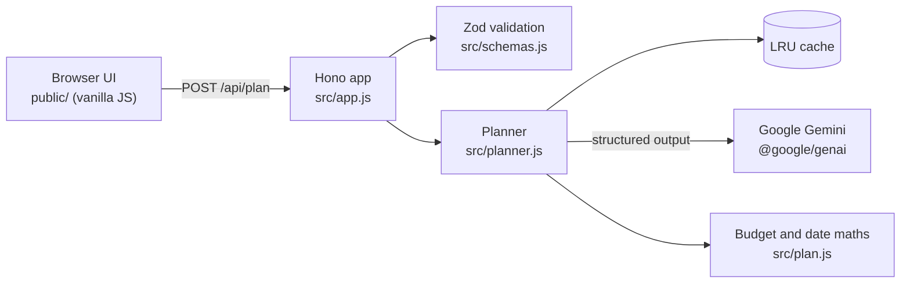

# 🎉 Celebrate: AI planning assistant for celebrations

> **PromptWars · Challenge 5: Celebration & Event Planner**

Celebrate turns a few details about a wedding, birthday or community event into a complete,
personalised plan: a **budget split**, a **dated timeline**, a **vendor checklist** and **creative
ideas**. Google Gemini generates the plan, and the user can refine it through conversation.

## What it does

| Challenge need                        | How Celebrate delivers it                                                                                                                                                       |
| ------------------------------------- | ------------------------------------------------------------------------------------------------------------------------------------------------------------------------------- |
| Weddings, birthdays, community events | Event-aware planning: ceremonies and traditions for weddings, age and interests for birthdays, permits, volunteers and safety for community events, plus "other celebrations"   |
| Budgets                               | Gemini proposes a category split that suits the location and budget per guest. The server turns it into exact amounts that always add up to the total                           |
| Timelines                             | Tasks become real calendar dates counted back from the event. Late tasks are flagged **Do now**, and one click exports every date to Google, Outlook or Apple Calendar (`.ics`) |
| Vendor checklists                     | Prioritised bookings with book-by dates and "what to ask" tips. Ticking off vendors shows progress, which is saved in the browser                                               |
| Personalised ideas                    | Theme, décor, food and activity ideas drawn from the stated preferences, culture, season and location                                                                           |
| Iteration                             | **Refine with AI** revises the current plan from plain-language feedback such as "cut costs by 20%"                                                                             |
| Inclusion                             | Plans in six languages. Every plan considers guest accessibility (step-free access, seating, diets) and low-waste choices                                                       |

## How GenAI is used

1. **Structured generation:** `gemini-3.6-flash` returns JSON constrained by `responseJsonSchema`.
   That schema is generated from the same Zod schema that validates the response
   ([src/schemas.js](src/schemas.js)), so the contract and the validation can never drift apart.
2. **AI for judgement, code for arithmetic:** the model chooses categories, shares, tasks, lead
   times and ideas. Deterministic code ([src/plan.js](src/plan.js)) computes amounts (using the
   largest-remainder method) and calendar dates. The prompt states facts the model would otherwise
   have to derive, such as days remaining and budget per guest.
3. **Conversational refinement:** the client sends the current plan and the user's feedback. The
   server re-validates both, so the API stays stateless and scales horizontally.
4. **Guardrails:** a fixed system instruction, user data passed as JSON inside delimited tags with
   `<` and `>` escaped (so it cannot close a tag), schema-constrained output, strict validation, and
   a friendly message when Gemini blocks a prompt.
5. **Latency and resilience:** low thinking level and an LRU cache for identical prompts. If a
   model is overloaded, slow or returns an unusable plan, the planner moves on to the next model
   (`gemini-3.5-flash-lite` by default) instead of re-asking the busy one. Each attempt has a
   30-second deadline that Gemini also enforces, and requests are cancelled when the browser
   disconnects. Measured live: a plan takes about 6 seconds on `gemini-3.6-flash` and 4 seconds on
   Flash-Lite.

## Architecture



```text
src/
  server.js      entry point: config, Gemini client, HTTP server, graceful shutdown
  app.js         routes, security headers, validation, error handling
  planner.js     Gemini call, response validation, caching, error mapping
  prompt.js      system instruction and prompt builder
  schemas.js     Zod schemas (request and AI response) and the Gemini JSON Schema
  plan.js        exact budget split and calendar scheduling
  rate-limit.js  per-client fixed-window rate limiter
  cache.js       LRU cache with expiry
  config.js      validated environment configuration
  dates.js       UTC calendar-day helpers
  errors.js      AppError with a user-safe message
public/          index.html, styles.css, js/ (main, app, render, ics)
test/            node:test suites: unit, integration, UI and accessibility
```

## Quick start

Requires Node.js 22.12 or later and a [Gemini API key](https://aistudio.google.com/apikey).

```bash
npm ci
cp .env.example .env    # then set GEMINI_API_KEY
npm run dev             # http://localhost:8080
```

| Script         | Purpose                                                                |
| -------------- | ---------------------------------------------------------------------- |
| `npm run dev`  | Start with auto-reload, loading `.env`                                 |
| `npm start`    | Start in production mode                                               |
| `npm test`     | Run all tests; fails unless every line, branch and function is covered |
| `npm run lint` | Biome lint and format check (`npm run format` applies fixes)           |

| Variable                | Default                                  | Purpose                                                       |
| ----------------------- | ---------------------------------------- | ------------------------------------------------------------- |
| `GEMINI_API_KEY`        | (required)                               | Gemini API key                                                |
| `GEMINI_MODELS`         | `gemini-3.6-flash,gemini-3.5-flash-lite` | Models to try, in order (each must support structured output) |
| `PORT`                  | `8080`                                   | HTTP port                                                     |
| `RATE_LIMIT_PER_MINUTE` | `10`                                     | Plan requests allowed per client per minute                   |
| `TRUST_PROXY`           | `false`                                  | Set to `true` on Cloud Run so limits use the real client IP   |

## Testing

Runs on Node's built-in test runner with no network access or API key: Gemini is replaced by a
test double.

- **Unit:** schemas, budget and date maths, prompt building, cache, rate limiter, configuration.
- **Service:** planner behaviour for success, caching, model fallback, malformed or incomplete AI
  output, blocked prompts, timeouts, quota errors, outages and abandoned requests.
- **HTTP integration:** the real Hono app via `app.request()`, covering validation errors,
  405/413/415/429 responses, security headers, ETag revalidation, compression and path traversal.
- **UI:** the real `index.html` and frontend modules in jsdom, covering validation and focus
  management, error reporting, rendering, persistence (including bookings kept across
  refinements), refinement and calendar export.
- **Accessibility:** axe-core with every WCAG 2.0, 2.1 and 2.2 A/AA rule plus best practices, run
  both before and after a plan renders.

99 tests cover 100% of lines, branches and functions in both the server and the browser code.
`npm test` enforces this as a hard threshold, and CI also runs lint and `npm audit`.

## Security

- The Gemini key stays on the server (in Secret Manager in production) and never reaches the browser.
- Strict Content Security Policy (`default-src 'self'`, no inline script or style) with
  **Trusted Types enforced**. The UI builds DOM nodes with text only and never uses `innerHTML`.
- Security headers: HSTS, `frame-ancestors 'none'` and `X-Frame-Options: DENY`, `nosniff`,
  `no-referrer`, COOP/COEP/CORP and a restrictive Permissions-Policy.
- Strict input validation: unknown keys are rejected, lengths, ranges and enums are checked, and
  control characters are refused. The API accepts JSON only (415) with a 64 KB body limit (413).
- AI output is untrusted: it is validated against the schema before use and rendered as text.
- Per-client rate limiting (429 with `Retry-After`) protects the AI quota. Memory use is bounded.
- Clients get safe error messages. Details go to structured logs with a request ID.
- Privacy: there is no database. Plans live only in the user's browser.
- Supply chain: four runtime dependencies, npm install scripts disabled, lockfile, Dependabot,
  CI actions pinned to commit SHAs, and a distroless, non-root container.

## Design

A neo-brutalist interface built entirely in [public/styles.css](public/styles.css), with no images
or web fonts: thick ink borders, hard offset shadows, flat bright colour blocks and chunky system
type with monospace accents.

- **One token set, two schemes.** Colours, lines and shadows are custom properties that flip for
  dark mode. Bright surfaces (yellow, pink, cyan, lime, violet) always carry dark ink, so they keep
  their contrast in both schemes.
- **Layout that explains itself.** On wide screens the form sits beside a board that previews what
  a plan contains, then becomes the plan: fact chips with a countdown, a colour-coded budget,
  dated timeline stickers, a tickable checklist and idea cards.
- **Accessible by construction.** Custom radios and checkboxes are real inputs styled with
  `appearance: none`. Decorative emoji are hidden from screen readers, rotations stay within a
  degree or two, and motion only runs when the user has not asked for reduced motion.

## Accessibility (WCAG 2.2 AA)

- Semantic landmarks, one `h1` with a logical heading order, and a skip link.
- Every field has a visible label. Hints and inline errors are linked with `aria-describedby`, and
  `aria-invalid` is set; focus moves to the first problem.
- Live regions announce progress, success and errors. Focus moves to the new plan when it arrives.
- AI text is tagged with the plan's language (WCAG 3.1.2, Language of Parts).
- Keyboard-operable native inputs with a visible 3 px focus ring and 44 px targets.
- Text contrast is at least 4.5:1 and control borders at least 3:1 in both light and dark schemes,
  measured in a real browser across every visible element. Status is never conveyed by colour
  alone.
- Respects `prefers-color-scheme`, `prefers-reduced-motion` and `forced-colors`, reflows to 320 px,
  and includes a print stylesheet.

## Efficiency

- No frontend framework, build step, web fonts or images: the whole UI is about 14 KB gzipped,
  with module preloading.
- Hono on Node.js, gzip compression, and ETag revalidation (304) for static files.
- Fewer AI calls and faster responses: low thinking level, a 100-entry LRU cache with a one-hour
  expiry, fallback to a faster model instead of retrying an overloaded one, and cancellation of
  abandoned requests.
- Stateless instances with bounded in-memory structures, so they scale out on Cloud Run.

## Deploy to Google Cloud Run

```bash
gcloud services enable run.googleapis.com cloudbuild.googleapis.com secretmanager.googleapis.com
printf '%s' "$GEMINI_API_KEY" | gcloud secrets create gemini-api-key --data-file=-
gcloud run deploy celebrate --source . --region asia-south1 --allow-unauthenticated \
  --set-secrets GEMINI_API_KEY=gemini-api-key:latest --set-env-vars TRUST_PROXY=true
```

The Cloud Run service account needs the `roles/secretmanager.secretAccessor` role on the secret.

## License

[MIT](LICENSE)
